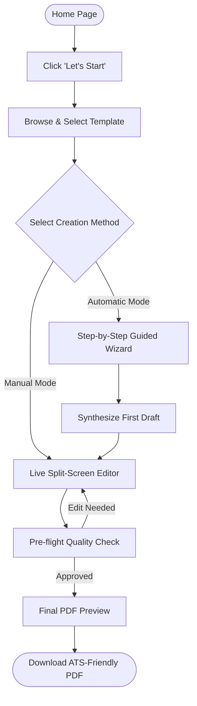
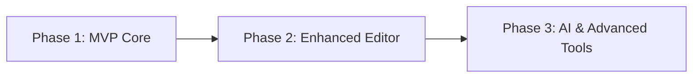

# ResumeCraft — Product Specification & Technical Architecture

> **Project Working Title:** ResumeCraft  
> **Document Version:** 2.0  
> **Target Platform:** Web (Desktop, Tablet, Mobile Responsive)  
> **Repository:** [Project3](file:///c:/Users/mrbat/Documents/Project3)

---

## Executive Summary

**ResumeCraft** is a modern, privacy-first, beginner-friendly web application designed to help job seekers, students, and professionals build ATS-friendly, beautifully formatted resumes without requiring design expertise. 

The application offers two distinct creation workflows:
1. **Manual Mode:** Direct form-based or in-place editing with immediate split-screen live preview.
2. **Automatic Mode (Guided Wizard):** A structured questionnaire that automatically formats, organizes, and styles the user's answers into a polished first draft ready for fine-tuning.

---

## Table of Contents
- [1. Project Overview & Vision](#1-project-overview--vision)
- [2. Target Audience & Personas](#2-target-audience--personas)
- [3. Complete User Journey](#3-complete-user-journey)
- [4. Core Functional Modules](#4-core-functional-modules)
  - [4.1 Home Page](#41-home-page)
  - [4.2 Template Gallery & Presets](#42-template-gallery--presets)
  - [4.3 Creation Workflows (Manual vs. Automatic)](#43-creation-workflows-manual-vs-automatic)
  - [4.4 Interactive Resume Editor](#44-interactive-resume-editor)
  - [4.5 Profile Photo Management](#45-profile-photo-management)
  - [4.6 Review, Pre-flight Checks & Export](#46-review-pre-flight-checks--export)
- [5. ATS Optimization & Design Standards](#5-ats-optimization--design-standards)
- [6. Canonical Resume Data Schema](#6-canonical-resume-data-schema)
- [7. Information Architecture & Routing](#7-information-architecture--routing)
- [8. Recommended Technology Stack](#8-recommended-technology-stack)
- [9. Data Privacy, Ethics & Security](#9-data-privacy-ethics--security)
- [10. Implementation Roadmap (Phases & MVP)](#10-implementation-roadmap-phases--mvp)
- [11. Success Metrics & Verification Criteria](#11-success-metrics--verification-criteria)

---

## 1. Project Overview & Vision

### 1.1 Purpose
Writing a resume from a blank document often causes formatting frustration, uncertainty over wording, and issues passing Applicant Tracking Systems (ATS). ResumeCraft removes this friction by providing a structured, intuitive pipeline that guides users from a blank slate to an interview-ready PDF.

### 1.2 Core Pillars
* **Accessibility & Simplicity:** Clean UI, zero required technical jargon, and minimal cognitive load.
* **Dual Creation Paradigm:** Gives confident writers granular control (Manual) while offering hesitant users structured guidance (Automatic).
* **Privacy by Default:** Client-side processing ensures user details remain on the client device without mandatory account creation.
* **High-Fidelity PDF Export:** Pixel-perfect, selectable-text PDFs that preserve typography and structure across all platforms.

---

## 2. Target Audience & Personas

| Persona | Primary Goal | Key Pain Points | Feature Alignment |
| :--- | :--- | :--- | :--- |
| **First-Time Student** | Apply for first internship or part-time job | Limited work history; doesn't know how to structure education/projects | *Automatic Wizard*, Student template highlighting coursework & extracurriculars |
| **Fresh Graduate** | Secure entry-level career position | Needs to articulate capstone projects, academic honors, and internships professionally | Skills categorization, project section templates, action-verb prompts |
| **Career Changer** | Transition to a new industry | Needs to emphasize transferable skills over standard chronological history | Functional / Hybrid layout options, modular section reordering |
| **Busy Professional** | Quickly update an existing CV | Needs speed, clean modern aesthetics, and quick PDF export | *Manual Mode*, instant live split-screen editor, modular additions |

---

## 3. Complete User Journey



### Detailed Step-by-Step Flow
1. **Home Page:** Explains value proposition, highlights template previews, displays clear "Let's Start" CTA.
2. **Template Selection:** User browses visual cards with live sample data and selects an initial design (switchable at any later stage without data loss).
3. **Creation Method Choice:** 
   - **Manual Mode:** Direct data entry into structured collapsible section forms with synchronized live visual preview.
   - **Automatic Mode:** Sequential, question-based wizard (5–7 bite-sized steps) that automatically compiles answers into a formatted resume draft.
4. **Draft Editing & Customization:** User edits sections, toggles optional blocks (certifications, photo, projects), and adjusts themes/fonts.
5. **Pre-flight Review:** Automated validation flags missing emails, empty bullet points, or overflow warnings.
6. **Export & Save:** Generates a clean PDF (`FirstName_LastName_Resume.pdf`) and persists resume data in browser `localStorage`.

---

## 4. Core Functional Modules

### 4.1 Home Page
* **Hero Section:** Clear headline (e.g., *"Build a Resume That Opens Doors"*), sub-headline, and high-visibility "Let's Start" CTA.
* **Interactive Template Showcase:** Carousel or grid displaying thumbnail previews of available templates with toggleable sample data.
* **Key Benefits & Value Propositions:**
  - ⚡ *Fast & Intuitive:* Ready in under 10 minutes.
  - 🔒 *100% Private:* Data stays in your browser; no forced sign-ups.
  - 📄 *ATS-Optimized:* Clean typography and semantic structure parseable by hiring software.
  - 🎨 *Switch Templates Anytime:* Change layouts with a single click without retyping data.
* **Social Proof / Feature Callouts:** Highlights of downloadable formats and customizable sections.

### 4.2 Template Gallery & Presets
Each template is built using responsive, semantic CSS designed for standard paper dimensions (US Letter `8.5" x 11"` and A4 `210mm x 297mm`).

| Template Preset | Target Profile | Design Characteristics | Photo Support |
| :--- | :--- | :--- | :--- |
| **Classic Standard** | Corporate, Finance, Law, Academia | Single column, serif/sans-serif headers, horizontal divider rules, high ATS score | Optional |
| **Modern Clean** | Tech, Startups, Marketing | Two-column asymmetric sidebar for contact/skills, clean sans-serif typography | Optional |
| **Minimalist** | General / Versatile | Generous whitespace, subtle typography hierarchy, minimal lines, clean readability | Optional |
| **Creative / Portfolio** | Design, Media, Communications | Subtle accent colors, badges for technical skills, prominent project links | Optional |
| **Student / Entry** | Internships, Recent Grads | Prioritizes Education, Coursework, Academic Honors, and Extracurricular Projects | Optional |

### 4.3 Creation Workflows (Manual vs. Automatic)

#### Option A: Manual Mode
* **Layout:** Desktop side-by-side view (Form on left 45%, Live PDF Page Preview on right 55%). Mobile uses a toggleable "Edit / Preview" segmented switch.
* **Form Sections (Collapsible & Reorderable):**
  1. Personal Information & Social Links (LinkedIn, GitHub, Portfolio)
  2. Professional Summary / Career Objective
  3. Work Experience (Company, Role, Dates, Location, Bullet points)
  4. Education (Institution, Degree, Dates, GPA/Honors optional)
  5. Skills (Categorized by Technical, Soft, Languages, or Tools)
  6. Projects (Title, Technologies, Link, Highlights)
  7. Certifications & Licenses
  8. Awards & Extracurricular Activities
  9. Custom Freeform Section
* **Capabilities:** Add/remove items dynamically, drag-to-reorder, and inline bullet formatting.

#### Option B: Automatic Mode (Guided Wizard)
* **Design:** Step-by-step conversational wizard with a visible progress bar (`Step X of 6`).
* **Guided Questions:**
  1. *Who are you?* Full name, target job title, location, email, phone, links.
  2. *What is your background?* Primary education details, recent graduation status.
  3. *What have you built or worked on?* Key roles or academic projects with prompts like *"What was your main achievement here?"*.
  4. *What are your top skills?* Chip-selector with common suggestions per target job title.
  5. *Do you have certifications or awards?* Optional input fields.
* **Synthesis Engine:**
  - Aggregates answers into the canonical resume data schema.
  - Formats raw bullet points into standardized, action-oriented resume statements (without fabricating facts or hallucinating qualifications).
  - Transitions the user directly into the Editor for final adjustments.

### 4.4 Interactive Resume Editor
* **Live Synchronization:** Zero-latency rendering updates the preview paper as the user types.
* **Styling Customizer:**
  - Accent Color Palette (6–8 curated accessible shades: Navy, Slate, Emerald, Burgundy, Cobalt, Charcoal).
  - Typography Pairings (Inter, Roboto, Merriweather, Lora, Open Sans).
  - Spacing & Font Size Controls (Compact, Normal, Relaxed) to manage page fit.
* **Page Break & Overflow Warning:** Visual indicator warning users if content overflows onto a second page.
* **State Management & History:** Local storage persistence and basic Undo/Redo support.

### 4.5 Profile Photo Management
* **Optional by Default:** Emphasizes that photos are discouraged in US/UK/Canada resumes but accepted in Europe/Asia/LATAM.
* **Client-Side Processing:**
  - Upload formats: PNG, JPG, WEBP (Max 5MB).
  - In-browser circular/square cropping.
  - Toggle visibility switch without deleting the uploaded image.

### 4.6 Review, Pre-flight Checks & Export
* **Pre-flight Checklist:**
  - [ ] Valid contact email and phone number present.
  - [ ] No empty bullet points or unedited placeholder text.
  - [ ] Check for single-line orphaned paragraphs.
* **Export Engine:**
  - Generates searchable, selectable-text PDF using browser printing engine or vector PDF generation (`window.print` with `@page` media rules or `@react-pdf/renderer`).
  - Standardized filename pattern: `{FirstName}_{LastName}_Resume.pdf`.
  - Secondary export: JSON export/import for backing up and restoring resume data.

---

## 5. ATS Optimization & Design Standards

To ensure maximum resume readability by recruitment algorithms:
1. **Semantic Hierarchy:** Strict heading levels (`<h1>` for Candidate Name, `<h2>` for Sections, `<h3>` for Job Titles/Institutions).
2. **Text Layer Preservation:** PDFs must contain raw selectable text, never rasterized image scans.
3. **Standard Section Naming:** Uses conventional labels (*"Work Experience"*, *"Education"*, *"Skills"*) that ATS parsers identify reliably.
4. **Clean Dates Format:** Consistent standard date formats (e.g., `MM/YYYY - Present` or `Sep 2023 - May 2026`).
5. **No Disruptive Graphics:** Avoid text hidden inside tables, floating text boxes, or complex background vector graphics that confuse OCR readers.

---

## 6. Canonical Resume Data Schema

To maintain complete interchangeability between templates and modes, data is stored in a clean TypeScript/JSON schema:

```typescript
interface ResumeData {
  metadata: {
    templateId: string;
    primaryColor: string;
    fontFamily: string;
    fontSize: 'compact' | 'normal' | 'relaxed';
    showPhoto: boolean;
    updatedAt: string;
  };
  basics: {
    fullName: string;
    headline: string; // e.g. "Software Engineer"
    email: string;
    phone: string;
    location: string;
    website?: string;
    linkedin?: string;
    github?: string;
    photoUrl?: string; // Base64 data URI
    summary: string;
  };
  education: Array<{
    id: string;
    institution: string;
    degree: string;
    fieldOfStudy: string;
    startDate: string;
    endDate: string;
    isCurrent: boolean;
    gpa?: string;
    honors?: string[];
  }>;
  experience: Array<{
    id: string;
    company: string;
    position: string;
    location?: string;
    startDate: string;
    endDate: string;
    isCurrent: boolean;
    bullets: string[];
  }>;
  skills: Array<{
    id: string;
    category: string; // e.g., "Languages", "Frameworks", "Soft Skills"
    items: string[];
  }>;
  projects: Array<{
    id: string;
    title: string;
    role?: string;
    link?: string;
    startDate?: string;
    endDate?: string;
    bullets: string[];
  }>;
  certifications?: Array<{
    id: string;
    name: string;
    issuer: string;
    issueDate: string;
    expiryDate?: string;
    credentialUrl?: string;
  }>;
  customSections?: Array<{
    id: string;
    title: string;
    items: string[];
  }>;
}
```

---

## 7. Information Architecture & Routing

| Route / View | Purpose | Primary Components |
| :--- | :--- | :--- |
| `/` | Landing page & feature showcase | HeroBanner, BenefitsGrid, TemplateCarousel, Footer |
| `/templates` | Dedicated gallery to browse templates | TemplateGrid, TemplatePreviewModal, FilterBar |
| `/wizard` | Step-by-step automatic questionnaire | StepProgressBar, GuidedQuestionCard, ActionButtons |
| `/builder` | Main split-screen editor & live preview | SectionAccordionList, FormattingToolbar, ResumePreviewCanvas |
| `/preview` | Full-screen pre-flight review & export | PreflightAuditCard, PrintEngineController, DownloadButton |

---

## 8. Recommended Technology Stack

| Layer | Recommended Choice | Rationale |
| :--- | :--- | :--- |
| **Framework** | **React (Vite) or Next.js** | Fast development, modular component ecosystem, client-side reactivity |
| **Language** | **TypeScript** | Type-safe data schema guarantees template interoperability |
| **Styling** | **Tailwind CSS** | Precise print styling utility classes (`print:m-0`, `print:shadow-none`), rapid UI styling |
| **Icons** | **Lucide React** | Lightweight, clean, modern UI iconography |
| **State Management** | **Zustand with `persist` middleware** | Lightweight state store with automatic sync to `localStorage` |
| **Image Cropping** | **react-easy-crop** | Smooth, mobile-friendly client-side photo cropping and zooming |
| **PDF Generation** | **CSS Paged Media (`@media print`) + html2pdf.js / `@react-pdf/renderer`** | Native browser print preserves 100% vector text quality and ATS compliance |

---

## 9. Data Privacy, Ethics & Security

1. **Local-First Architecture:** 
   - 100% of resume data and uploaded photos remain in the user's browser memory / `localStorage`.
   - No external databases or servers receive personally identifiable information (PII).
2. **Clear Data Controls:** 
   - One-click "Clear All Data" button to purge local storage.
   - One-click "Export Data (JSON)" and "Import Data (JSON)" for user data portability.
3. **No Hallucinations / Ethical Formatting:**
   - The system organizes and formats only what the user provides.
   - It will never fabricate dates, job titles, companies, or credentials.
4. **Third-Party Transparency:**
   - If AI enhancements (e.g. action-verb suggestions) are added in the future, explicit user consent is required before sending anonymized text snippets to an API.

---

## 10. Implementation Roadmap (Phases & MVP)



### Phase 1: Minimum Viable Product (MVP)
- [x] Comprehensive requirements & data model specification.
- [ ] Landing page with hero section and "Let's Start" entry point.
- [ ] 3 core ATS-compliant templates: Classic, Modern, Minimalist.
- [ ] Manual input form with real-time synchronized preview.
- [ ] Guided Automatic Mode questionnaire generating a populated resume draft.
- [ ] Client-side photo upload with circular crop.
- [ ] Vector PDF export via print CSS & download button.
- [ ] Auto-save progress to `localStorage`.

### Phase 2: Enhanced Editor & Customization
- [ ] Drag-and-drop section reordering.
- [ ] Color palette switcher and typography selection.
- [ ] Pre-flight audit system (checking for blank fields, orphaned text).
- [ ] Additional templates (Creative, Student/Grad focus).
- [ ] JSON backup export and import.

### Phase 3: Advanced Capabilities (Post-MVP)
- [ ] AI-powered bullet point improver (action verb enhancer, STAR method guidance).
- [ ] Job description keyword matching scanner.
- [ ] Matching Cover Letter builder sharing the same theme and contact header.
- [ ] Cloud synchronization & multi-resume profile management (optional user accounts).

---

## 11. Success Metrics & Verification Criteria

| Criterion | Target Metric | Verification Method |
| :--- | :--- | :--- |
| **Time to First Resume** | < 8 minutes | User testing session from landing page to PDF download via Automatic Mode |
| **Ease of Use** | Zero technical guidance required | First-time user completes download without error prompts |
| **Export Fidelity** | 100% text selectability | PDF tested in Acrobat / Preview; all characters copy-pasteable |
| **ATS Compatibility** | 90%+ parse accuracy | Run sample exported PDF through popular ATS resume parsers |
| **Data Privacy** | 0 outbound PII requests | Network inspection confirms no personal data leaves client browser |
| **Responsiveness** | Seamless on mobile & desktop | UI passes Lighthouse Mobile Usability and Viewport tests |